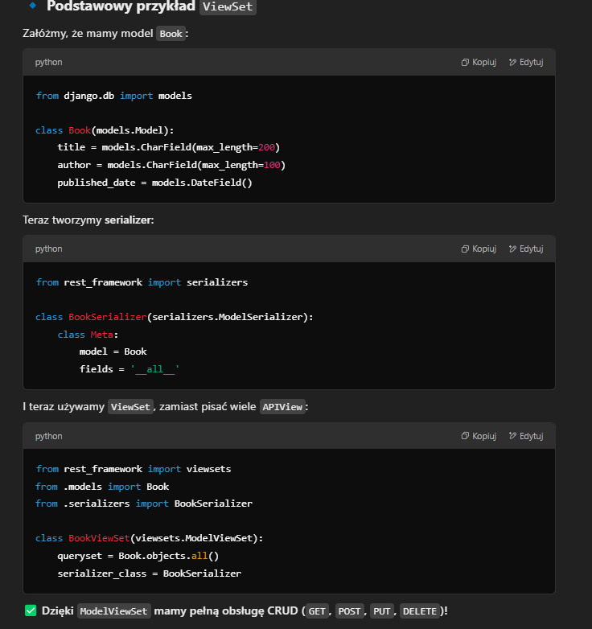
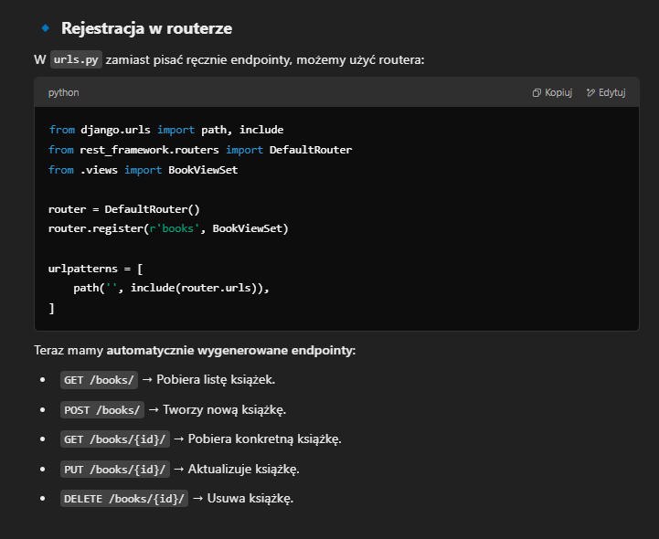

# Co to jest ViewSet w Django?
W Django REST framework (DRF), ViewSet to specjalna klasa, która łączy logikę CRUD w jednym miejscu, 
eliminując konieczność pisania osobnych APIView dla różnych operacji.

W skrócie:

ViewSet to zestaw widoków dla określonego modelu/danych.
Sam `ViewSet` nie implementuje operacji CRUD. Akcje, takie jak `list()` i `create()`, trzeba zdefiniować samodzielnie.
`ModelViewSet` dostarcza standardowe akcje CRUD, w tym `partial_update()` dla PATCH.
Router mapuje zaimplementowane akcje na metody HTTP i adresy URL.

Źródło: [DRF — ViewSets](https://www.django-rest-framework.org/api-guide/viewsets/).
Współpracuje z routerami (routers.DefaultRouter), co upraszcza zarządzanie URL-ami.

